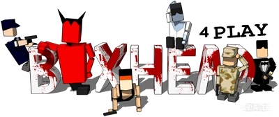

# boxHead remake

[中文](README.md) | **English**



A remake of the Flash game **Boxhead 2Play** built with **Godot 4.7** (GL Compatibility).

Boxhead 2Play is a top-down zombie survival shooter from the 2000s: you fight waves inside a closed
room, chaining kills to raise a score multiplier. This project decompiles the original SWF and restores
its stats, state machines and art, aiming for behaviour that **matches the original**.

> Still a work in progress: core gameplay is playable, multiplayer and save/high scores are not.
> See [doc/known-issues.md](doc/known-issues.md) for known problems and open questions.

---

## Gameplay

- **Top-down 2D shooting**: keyboard only, 8-direction movement + 8-direction shooting (**no mouse**);
  the character faces the last movement direction held.
- **1-4 local players plus CPU teammates**: in the level select each slot can be
  `off / 1P / 2P / 3P / 4P / CPU`, each player having own keys, own character and own health bar;
  empty slots can be filled by CPU players.
- **4 selectable characters**: SWAT / BOND / GIJOE / BAMBO. The art comes from an offline bake of the
  original XSI renderer (see [doc/xsi-sprite-skins.md](doc/xsi-sprite-skins.md)); a hue shift is only
  applied when two slots picked the same character.
- **Waves of zombies**: kills build a score multiplier; multiplier tiers unlock new weapons and upgrades
  (press `TAB` to view them).
- **Two enemy types**:
  - **Zombies**: melee biters that swarm using grid pathfinding and cell reservation so they do not stack.
  - **Devils**: ranged fireballs; they destroy barrels and fake walls blocking the way.
- **10 weapons**: pistol, UZI, shotgun, railgun, rocket, grenade, mine, charge pack, fake wall, barrel.
  Damage / fire rate / ammo / pellet count / knockback are all converted from the original; thrown weapons
  have charge distance, bouncing and chain explosions.
- **Level interaction**: barrels explode, fake walls break, supply crates give loot (contents are rolled
  with the original's weighted rules: the emptier the magazine, the likelier that weapon).
- **Ground decals**: blood splats and scorch marks stay on the floor; can be disabled in settings.
- **Death and respawn**: delayed respawn, respawn point prefers a free cell near living teammates;
  **respawn keeps every unlocked weapon** (only the ammo is emptied), as in the original.
- **18 rooms**: switched per level, sizes and obstacle layouts rebuilt from the original maps.

---

## Feature status

| Module | Status | Notes |
|---|---|---|
| Movement / aiming / shooting | Done | 8-direction animation; facing = shooting direction; muzzle anchors configured per weapon × direction (`offsetDir` in `script/weapon/*.gd`) |
| Character skins | Done | 4 original character sets, uniform 160×156 canvas with a fixed foot anchor; generator: `doc/tools/gen_player_skins.py` |
| Weapons | Done | 10 weapons, damage / fire rate / ammo / recoil / pellet count matching the original |
| Zombie AI | Done | State machine + flow-field pathfinding + target-cell reservation |
| Devil AI | Done | Fireballs, obstacle removal, line-of-sight checks; shares the multi-source flow field |
| Pathfinding | Done | Multi-source flow field (BFS to all living players), 8-neighbour with diagonal weights; CPUs use a separate enemy-source distance field |
| Damage / knockback | Done | Knockback follows the original "damage × mass" geometric decay; lethal hits knock back before dying |
| Score / kill streak | Done | Multiplier, floating score, supply crates dropped on the original curve |
| Upgrades / unlocks | Done | 58-tier upgrade table (multiplier up to 125), `TAB` to view; high difficulties pre-grant upgrades like the original |
| CPU player AI | Done | Beehave behaviour tree: perception / strategies (aggressive, defensive, support, kiter, patrol) / weapon choice / rescue / demolition / survival, see [doc/cpu-player-ai.md](doc/cpu-player-ai.md) |
| Ground decals | Done | Blood + scorch, toggleable in settings; see [doc/decals-blood-scorch.md](doc/decals-blood-scorch.md) |
| Screen shake | Done | Triggered by explosions, tunable and toggleable |
| Rooms / levels | Done | All 18 rooms have skeleton, obstacle cells and spawn points configured, plus editors (below) |
| Audio / localisation | Done | Sound set matches the original; Chinese / English switch (`lang/lang.csv`) |
| Pause menu | Done | `ESC` to pause, with "Resume / Main Menu" |
| Automated testing | Done | TestBridge (TCP JSON) + checklist [doc/test-checklist.md](doc/test-checklist.md) |
| LAN multiplayer | **Design only** | Host-authoritative + ENet, see [doc/lan-multiplayer.md](doc/lan-multiplayer.md); not implemented |
| Save / high scores | Not started | Only settings are persisted (`autoload/settings.gd`) |

---

## Controls

**Keyboard only, no mouse** (same as the original).

| Player | Move | Fire | Switch weapon |
|---|---|---|---|
| **P1** | `W` `A` `S` `D` | `F` | `E` / `Q` |
| **P2** | `I` `J` `K` `L` | `;` | `U` / `O` |
| **P3** | `↑` `←` `↓` `→` | `/` | `.` / `,` |
| **P4** | Numpad `8` `4` `5` `6` | Numpad `0` | Numpad `2` / `1` |

General: `ESC` pause menu, `TAB` shows acquired upgrades.
All keys can be rebound in **Settings → Key Bindings**.

---

## Quick start

1. Install **Godot 4.7** (standard build, no .NET needed).
2. Open `box-head-remake/project.godot` in Godot.
3. Run (`F5`): the main scene is the welcome screen → level select (map / slots / characters / difficulty) → game.

> The first open imports all art assets (4 player skins + about 2300 PNGs for zombies and devils), so it takes a moment.
> Command-line import: `Godot_v4.7.2 --headless --path box-head-remake --import`.

### Test scenes

| Scene | Purpose |
|---|---|
| `scene/test/test_rooms.tscn` | Inspect each room: size, obstacle cells, spawn points |
| `scene/test/test_obstacles.tscn` | **Obstacle editor**: switch maps, zoom/pan; left click adds, right click deletes, Shift-drag for a rectangle; `S` writes `wallObstacles` back into the room `.tscn` |
| `scene/test/test_spawns.tscn` | **Spawn / barrel / wall editor**: static obstacles read-only; walls, barrels and enemy spawns editable; player spawns per slot P1~P4 (`, .` to switch), `S` writes back `wallPoint` / `barrelPoint` / map_sign nodes |
| `scene/test/test_weapons.tscn` | Full weapon firing range, with add/remove enemies and unlock-weapon buttons |
| `scene/test/test_death.tscn` | Multi-player death and respawn |
| `scene/test/test_devils.tscn` | Devil-specific: fireballs, obstacle removal, distance keeping |
| `scene/test/test_flow_field.tscn` | Flow-field visualisation and zombie pathfinding stress test |
| `scene/test/test_shake.tscn` | Explosion screen shake: single / many per frame / chained / BigBang stacking and tuning |
| `scene/test/test_cpu.tscn` | CPU player AI: 1 human + 0-3 CPUs (Beehave trees), spawn enemies, toggle friendly fire / strategy, grant weapons, drain HP, pause AI |

### Automated testing (TestBridge)

The game can be driven over TCP to read runtime state and inject commands (works both in the editor and in
an exported build — note the `--` separator):

```powershell
Godot_v4.7.2 --path box-head-remake -- --test-bridge --test-bridge-port=28765

python doc/tools/run_bridge_tests.py                                       # bridge self-check + CPU behaviour
python doc/tools/run_bridge_tests.py --longrun --minutes 5 --time-scale 3  # long-run sampling
```

Commands and assertions are listed in [doc/test-checklist.md](doc/test-checklist.md).

---

## Art provenance (important)

The original `Boxhead_2Play.swf` contains **no** ready-made character sprites: players, zombies and devils
are rendered at runtime from XSI polygon data by the game's own renderer. (Only the *More Rooms* expansion
shipped baked sprite sheets, which is why that file looks like it has art.)

The character art in this project comes from **baking that XSI renderer offline into PNGs**; direction
mapping, canvas/anchor conventions and the generator scripts live in
[doc/xsi-sprite-skins.md](doc/xsi-sprite-skins.md). The old MoreRooms assets
(`sprite/player/DefineSprite_*`, `sprite/Zombie2`, `sprite/Devil`) are no longer referenced and can be
deleted once the new look is confirmed.

---

## Playing the original (Ruffle)

`oldGame/` contains the original Flash files, which run directly in [Ruffle](https://ruffle.rs/) (no Flash needed):

| File | Description |
|---|---|
| `oldGame/Boxhead_2Play.swf` | The original Boxhead 2Play (what this project recreates) |
| `oldGame/boxheadmorerooms.swf` | The More Rooms expansion (extra rooms) |

**Desktop**: download Ruffle and drop a `.swf` into its window.
**Browser**: upload the swf at <https://ruffle.rs/demo/>, or install the Ruffle browser extension and open the local file.

`oldGame/_decompiled/` holds the decompiled ActionScript (git-ignored) and is only used for comparing stats and logic.

---

## Documentation

Reverse-engineering notes, design docs and stat tables are in `doc/`; the index is [doc/README.md](doc/README.md) (Chinese):

| Document | Contents |
|---|---|
| [doc/00-overview.md](doc/00-overview.md) | Overview: SWF metadata, engine architecture, main loop, global switches |
| [doc/01-enemy-ai.md](doc/01-enemy-ai.md) | Enemy AI and spawning (state machines, predicates) |
| [doc/02-pathfinding.md](doc/02-pathfinding.md) | Map representation and flow-field pathfinding |
| [doc/03-weapons.md](doc/03-weapons.md) | All weapon stats and the upgrade table |
| [doc/04-enemy-stats.md](doc/04-enemy-stats.md) | Enemy / player stats, levels, difficulty curve |
| [doc/cpu-player-ai.md](doc/cpu-player-ai.md) | CPU player AI: Beehave decision layer, distance fields, strategies |
| [doc/decals-blood-scorch.md](doc/decals-blood-scorch.md) | Blood and scorch ground decals, settings toggle |
| [doc/xsi-sprite-skins.md](doc/xsi-sprite-skins.md) | Replacing art with the original XSI bake: 4 player skins + zombie / devil |
| [doc/lan-multiplayer.md](doc/lan-multiplayer.md) | LAN multiplayer design (host authority, seat model, optional CPUs, window lifecycle) |
| [doc/test-checklist.md](doc/test-checklist.md) | Automated testing: TestBridge commands, checklist, long-run sampling |
| [doc/known-issues.md](doc/known-issues.md) | Audit list: fixed items, open questions, gaps vs the original |
| [doc/future-improvements.md](doc/future-improvements.md) | Optimisation proposals (incremental flow-field refresh, etc.) |
| [code_design.md](code_design.md) | Coding conventions: naming, typing, file layout, architecture (**this project deliberately does not use Godot's snake_case defaults**) |
| `box-head-remake/doc/map_layouts/` | Per-room ASCII layouts and marker details |

---

## Repository layout

```
box-head-remake/        Godot project
  scene/                scenes (rooms, characters, weapons, UI, tests)
  script/               scripts (characters, state machines, AI, weapons, level, UI, tests)
  sprite/               art (character skins, monsters, FX, UI)
  sound/  font/  theme/  shader/  lang/
  autoload/             singletons (Game, MapData, Settings, SoundUtil, TestBridge…)
  addons/beehave/       CPU behaviour-tree plugin (third party)
  doc/map_layouts/      ASCII room layouts
doc/                    reverse-engineering notes and design docs
oldGame/                original SWFs and decompiled sources (read-only reference)
code_design.md          coding conventions
```

---

## License

See [LICENSE](LICENSE). The original game is property of its authors; this project is for study and remake research only.
