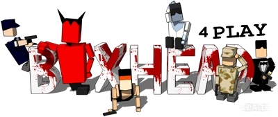

# boxHead remake

**中文** | [English](README.en.md)



用 **Godot 4.7**（GL Compatibility）重制 Flash 小游戏 **Boxhead 2Play**（箱子头：双人版）。

原版是 2000 年代的 Flash 俯视角僵尸生存射击游戏：玩家在封闭房间里边打边跑，靠连杀叠倍率刷分。本项目通过反编译原版 SWF 逐项还原数值、状态机与美术资源，目标是**行为与原版一致**的重制版。

> 仍在开发中：核心玩法可玩，联机与存档尚未实现；已知问题与待确认项见 [doc/known-issues.md](doc/known-issues.md)。

---

## 玩法

- **俯视角 2D 射击**：纯键盘操作，8 方向移动 + 8 方向射击（**不使用鼠标**），角色朝向 = 最后按下的移动方向。
- **本地 1~4 人 + CPU 队友**：关卡选择里每个槽位可设为 `关闭 / 1P / 2P / 3P / 4P / CPU`，每人独立按键、独立角色、独立血量；空位可由 CPU 玩家补上。
- **4 个可选角色**：SWAT / BOND / GIJOE / BAMBO，素材来自原版 XSI 渲染的离线烘焙（见 [doc/xsi-sprite-skins.md](doc/xsi-sprite-skins.md)）；只有多个槽位撞同一个角色时才用色相染色区分。
- **一波波僵尸**：击杀累积连杀倍率，倍率越高分数越高；连杀档位解锁新武器与升级（`TAB` 查看列表）。
- **两种敌人**：
  - **僵尸**：近身撕咬，成群走格子寻路，靠格子占位避免叠在一起。
  - **恶魔**：远程火球，会拆掉挡路的油桶和假墙。
- **10 种武器**：手枪、UZI、霰弹枪、轨道炮、火箭、手榴弹、地雷、充电包、假墙、油桶。
  - 数值 / 射速 / 弹药 / 弹丸数 / 击退全部按原版换算；投掷物有蓄力距离、落地弹跳、爆炸溅射与连锁爆炸。
- **场景交互**：油桶可打爆、假墙可拆、箱子提供补给（内容按原版加权随机：越缺弹的枪越容易抽到）。
- **地面贴花**：血迹与爆炸焦痕会留在地上，可在设置里关闭。
- **死亡与复活**：阵亡后延迟复活，复活点优先选在存活队友附近的空位；**复活保留已解锁武器**（只清空弹药），与原版一致。
- **18 个房间**：按关卡切换，尺寸与障碍布局按原版地图还原。

---

## 功能概况

| 模块 | 状态 | 说明 |
|---|---|---|
| 玩家移动 / 瞄准 / 射击 | 完成 | 8 方向动画，朝向即射击方向；枪口锚点按"武器 × 方向"配置（`script/weapon/*.gd` 的 `offsetDir`） |
| 角色皮肤 | 完成 | 4 套原版角色素材，统一 160×156 画布 + 脚底锚点；生成脚本 `doc/tools/gen_player_skins.py` |
| 武器系统 | 完成 | 10 种武器，伤害 / 射速 / 弹药 / 后坐力 / 弹丸数对齐原版 |
| 僵尸 AI | 完成 | 状态机 + 流场寻路 + 目标格占位，避免互相挤压 |
| 恶魔 AI | 完成 | 火球、拆障碍、通视检测；与僵尸共用多源流场 |
| 寻路 | 完成 | 多源流场（BFS 到所有存活玩家），8 邻域带对角权重；CPU 另有敌人源距离场 |
| 伤害 / 击退 | 完成 | 击退按原版"伤害 × 质量"几何衰减，致命伤先击退再倒地 |
| 得分 / 连杀 | 完成 | 连杀倍率、飘分特效、按原版曲线掉落补给箱 |
| 升级 / 解锁 | 完成 | 58 档升级表（倍率最高到 125），`TAB` 查看；高难度开局会像原版一样预发升级 |
| CPU 玩家 AI | 完成 | Beehave 行为树：感知 / 策略（进攻·防守·支援·放风筝·巡逻）/ 选枪 / 救援 / 拆障 / 自保，见 [doc/cpu-player-ai.md](doc/cpu-player-ai.md) |
| 地面贴花 | 完成 | 血迹 + 爆炸焦痕，设置里可关；实现见 [doc/decals-blood-scorch.md](doc/decals-blood-scorch.md) |
| 画面抖动 | 完成 | 爆炸触发，强度 / 衰减可调，设置里可关 |
| 房间 / 关卡 | 完成 | 18 个房间的骨架、障碍格、出生点均已配置，并有配套编辑器 |
| 音效 / 多语言 | 完成 | 音效对齐原版；中英文切换（`lang/lang.csv`） |
| 暂停菜单 | 完成 | `ESC` 暂停，含「继续游戏 / 返回主菜单」 |
| 自动化测试 | 完成 | TestBridge（TCP JSON）+ 测试清单 [doc/test-checklist.md](doc/test-checklist.md) |
| 局域网联机 | **仅设计** | 主机权威 + ENet，方案见 [doc/lan-multiplayer.md](doc/lan-multiplayer.md)，代码未实现 |
| 存档 / 排行榜 | 未开始 | 目前只持久化设置项（`autoload/settings.gd`） |

---

## 操作

**纯键盘，不使用鼠标**（和原版一致）：角色朝向 = 最后按下的移动方向，射击也沿这个 8 方向飞出。

| 玩家 | 移动 | 开火 | 换武器 |
|---|---|---|---|
| **P1** | `W` `A` `S` `D` | `F` | `E` / `Q` |
| **P2** | `I` `J` `K` `L` | `;` | `U` / `O` |
| **P3** | `↑` `←` `↓` `→` | `/` | `.` / `,` |
| **P4** | 小键盘 `8` `4` `5` `6` | 小键盘 `0` | 小键盘 `2` / `1` |

通用：`ESC` 暂停菜单，`TAB` 查看已获升级。

按键都可以在 **设置 → 按键设置** 里改。

---

## 快速开始

1. 安装 **Godot 4.7**（标准版，无需 .NET）。
2. 用 Godot 打开 `box-head-remake/project.godot`。
3. 直接运行（`F5`）：主场景是欢迎界面 → 关卡选择（选地图 / 槽位 / 角色 / 难度）→ 进入游戏。

> 首次打开会导入全部美术资源（玩家 4 套皮肤 + 僵尸 / 恶魔约 2300 张 PNG），需要等一会儿。
> 命令行导入：`Godot_v4.7.2 --headless --path box-head-remake --import`。

测试场景：

| 场景 | 用途 |
|---|---|
| `scene/test/test_rooms.tscn` | 逐个房间查看尺寸、障碍格、出生点 |
| `scene/test/test_obstacles.tscn` | **障碍格编辑器**：切地图 / 缩放平移；左键加、右键删、Shift 拖拽矩形批量；`S` 直接写回房间 `.tscn` 的 `wallObstacles` |
| `scene/test/test_spawns.tscn` | **出生点 / 油桶 / 墙编辑器**：静态障碍只读；墙、油桶、僵尸/恶魔出生点可编辑；玩家出生点按槽位 P1~P4（` , . ` 切槽），`S` 写回 `wallPoint` / `barrelPoint` / map_sign 节点 |
| `scene/test/test_weapons.tscn` | 全武器靶场，含增删敌人 / 解锁武器按钮 |
| `scene/test/test_death.tscn` | 多玩家死亡与复活测试 |
| `scene/test/test_devils.tscn` | 恶魔专项：火球、拆障碍、保持距离 |
| `scene/test/test_flow_field.tscn` | 流场可视化与僵尸寻路压力测试 |
| `scene/test/test_shake.tscn` | 爆炸画面抖动：单发 / 同帧多发 / 连锁 / BigBang 叠加与参数调节 |
| `scene/test/test_cpu.tscn` | CPU 玩家 AI：1 人类 + 0~3 CPU（Beehave 行为树），可刷怪、切友伤/策略、发枪、压血、暂停 AI |

### 自动化测试（TestBridge）

游戏可以被外部通过 TCP 驱动，读取运行时状态并注入命令（编辑器或导出的 exe 都支持，注意 `--` 分隔符）：

```powershell
Godot_v4.7.2 --path box-head-remake -- --test-bridge --test-bridge-port=28765

python doc/tools/run_bridge_tests.py                              # 桥接自检 + CPU 行为
python doc/tools/run_bridge_tests.py --longrun --minutes 5 --time-scale 3   # 长跑采样
```

命令与断言清单见 [doc/test-checklist.md](doc/test-checklist.md)。

---

## 美术来源（重要）

原版 `Boxhead_2Play.swf` 里**没有**整张角色贴图：玩家 / 僵尸 / 恶魔都是运行时用 XSI 多边形数据
+ 游戏自带渲染器现算出来的（More Rooms 扩展版才烘焙成序列帧，所以只有它是"看得见的美术资源"）。

本项目的角色素材来自把这套 XSI 渲染**离线烘焙成 PNG** 的产物；方向映射、画布与锚点约定、生成脚本都在
[doc/xsi-sprite-skins.md](doc/xsi-sprite-skins.md)。旧的 MoreRooms 素材（`sprite/player/DefineSprite_*`、
`sprite/Zombie2`、`sprite/Devil`）已不再被引用，确认后删除。

---

## 玩原版（Ruffle）

`oldGame/` 里放着原版 Flash 文件，用 [Ruffle](https://ruffle.rs/) 就能直接运行（不需要装 Flash）：

| 文件 | 说明 |
|---|---|
| `oldGame/Boxhead_2Play.swf` | 原版 Boxhead 2Play（本项目还原的对象）|
| `oldGame/boxheadmorerooms.swf` | More Rooms 扩展版（更多房间）|

**桌面版**：下载 Ruffle 后，把 `.swf` 拖进窗口即可。

**浏览器版**：在 <https://ruffle.rs/demo/> 上传 swf 文件，或装 Ruffle 浏览器扩展后直接打开本地 swf。

`oldGame/_decompiled/` 是反编译出的 AS 源码，只用来对照数值和逻辑，不需要运行。

---

## 文档

逆向记录、设计文档与数值对照都在 `doc/`，索引见 [doc/README.md](doc/README.md)：

| 文档 | 内容 |
|---|---|
| [doc/00-overview.md](doc/00-overview.md) | 总览：SWF 元信息、引擎架构、主循环、全局开关 |
| [doc/01-enemy-ai.md](doc/01-enemy-ai.md) | 敌人 AI 与刷怪机制（状态机、判定谓词） |
| [doc/02-pathfinding.md](doc/02-pathfinding.md) | 地图表示与流场寻路 |
| [doc/03-weapons.md](doc/03-weapons.md) | 全部武器数值与升级表 |
| [doc/04-enemy-stats.md](doc/04-enemy-stats.md) | 敌人 / 玩家数值、关卡与难度曲线 |
| [doc/cpu-player-ai.md](doc/cpu-player-ai.md) | CPU 玩家 AI：Beehave 决策层、距离场导航、策略与选枪 |
| [doc/decals-blood-scorch.md](doc/decals-blood-scorch.md) | 血迹与爆炸焦痕（地面贴花）实现与设置开关 |
| [doc/xsi-sprite-skins.md](doc/xsi-sprite-skins.md) | 原版 XSI 烘焙素材替换：玩家 4 套皮肤 + 僵尸 / 恶魔 |
| [doc/lan-multiplayer.md](doc/lan-multiplayer.md) | 局域网联机设计（主机权威、座位模型、CPU 可选、窗口生命周期）|
| [doc/test-checklist.md](doc/test-checklist.md) | 自动化测试：TestBridge 命令、测试清单、长跑采样 |
| [doc/known-issues.md](doc/known-issues.md) | 体检问题清单：已修项、待确认项、与原版的差距 |
| [doc/future-improvements.md](doc/future-improvements.md) | 优化提案（大图流场局部刷新等） |
| [code_design.md](code_design.md) | 编码规范：命名、类型、文件结构、架构约定（**本项目不用官方 snake_case**）|
| `box-head-remake/doc/map_layouts/` | 每个房间的字符画布局与标记明细 |

---

## 目录结构

```
box-head-remake/        Godot 项目
  scene/                场景（房间、角色、武器、UI、测试）
  script/               脚本（角色、状态机、AI、武器、关卡、UI、测试）
  sprite/               美术资源（角色皮肤、怪物、特效、UI）
  sound/  font/  theme/  shader/  lang/
  autoload/             全局单例（Game、MapData、Settings、SoundUtil、TestBridge…）
  addons/beehave/       CPU 行为树插件（第三方）
  doc/map_layouts/      房间布局字符画
doc/                    逆向文档、设计文档
oldGame/                原版 SWF 与反编译源码（只读参考）
code_design.md          编码规范
```

---

## 许可

见 [LICENSE](LICENSE)。原版游戏版权归原作者所有，本项目仅用于学习与重制研究。
